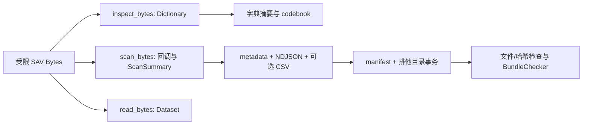
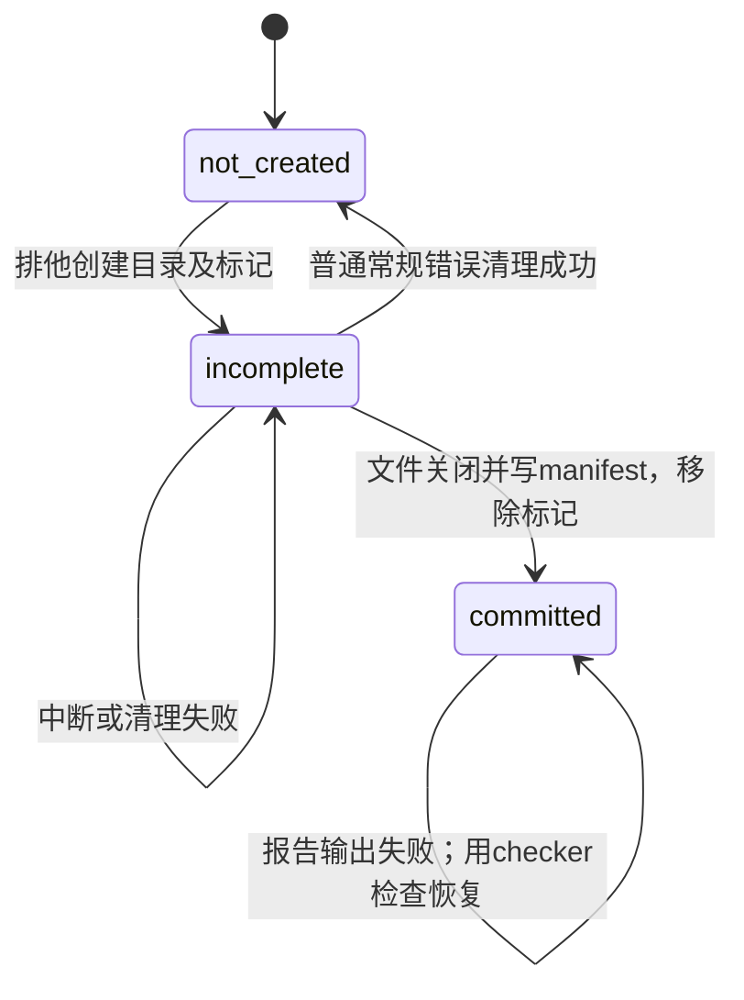

# MoonSav 对象与输入输出契约

更新：2026-11-06。适用于本仓库 v0.1 候选版。以公开 MoonBit 接口、四份 JSON Schema、实际校验器和回归共同约束；原 PRD 中的设计伪签名不是现行调用语法。

本文描述全部受支持的对象及入口，也明确哪些是调用前提、哪些会由程序检查。它不代表指定验收对话已批准。字段类型中的 `?` 是 MoonBit `Option`；对应可序列化字段在 JSON 中为显式 `null`，不等同于省略字段。

## 1. 数据流与职责

- MoonBit 负责二进制格式、字典、压缩、编码选择、缺失/标签、规范表示和 bundle 语义。
- Node 负责本地文件、严格 codec、SHA256、分帧、进程通道与排他目录事务。Python/ReadStat/PSPP 仅作开发对照。
- `inspect` 只检查字典，不能证明数据区完整。只有扫描到结束且行数一致的结果才是全文件通过。
- 字节解析入口不读取文件、不打印、不退出进程；CLI 文件入口只读取本地普通文件。不是流式文件解析器，完整 SAV 输入仍在内存。

## 2. 公共入口

参数顺序和异常语法以 `src/pkg.generated.mbti` 为准。

| 入口 | 输入 | 输出/副作用 | 失败或调用前提 |
| --- | --- | --- | --- |
| `probe_header(Bytes) -> Int raise SavError` | 至少含头部的字节 | 返回布局码 2 或 3 | 仅探测 magic/176-byte 头/布局；不检查字典、编码或数据，也不应用 Options 预算 |
| `inspect_bytes(Bytes, options?) -> Dictionary raise SavError` | SAV 完整字节、Options | 经过结构/语义检查的字典，无文件写入 | 验证输入/字典/编码/资源；未扫描数据；尾部损坏可能尚未发现 |
| `read_bytes(Bytes, options?) -> Dataset raise SavError` | 同上，适合较小数据 | 完整字典及收集的行 | 必须扫到 EOF；另检查 cells/retained_bytes；不默默截断 |
| `scan_bytes(Bytes, on_dictionary, on_row, options?) -> ScanSummary raise SavError` | 同上，同步回调 | 字典一次、逐行回调、计数；同步背压 | Stop 是主动部分扫描；回调异常为 ConsumerFailed；调用方缓存不计入库预算 |
| `Variable.value_label_for(Cell) -> String? raise SavError` | 该列的合法 Cell | 标签或 None，不替换原值 | 类型不同或系统缺失返回 None；未标注的合法值也返回 None；其余输入须为合法 Cell |
| `Cell.is_missing() -> Bool` / `missing_kind() -> String` | 合法 Cell | 缺失判断/种类 | 对应 `present/user/system`，不猜 99 或空白 |
| `SavError.info() -> ErrorInfo` | SavError | 结构化错误 | 错误上下文按可获得程度提供 |
| `Dictionary/Variable/Cell/Atom/EncodingInfo/Extra/ErrorInfo/Limits/Format/ValueLabel/Warning/ScanSummary.to_json()` | 合法对象 | 已知字段的 JSON 表示 | 不是任意手工对象的验证器；对序列化助手传入的集合，调用期间不得并发修改 |
| `metadata_json(Dictionary, actual_rows) -> Json` | 合法字典及经完整扫描确认的实际行数 | full metadata | 低层序列化器：调用者保证 actual_rows 合法且与扫描一致；不重新扫描 SAV |
| `row_json(Array[Cell], index) -> String` | 合法的一行、合法零基行号 | 一条带 LF 的 NDJSON | 低层序列化器：调用者保证列顺序/类型/行号，不能把任意手工 Cell 当已验证数据 |
| `csv_header(Dictionary) -> String` | 未被调用方改坏的合法字典 | RFC4180 表头及 CRLF | 字典入口保证名字非空、无 NUL；这是低层序列化器的前提 |
| `csv_row(Array[Cell]) -> String raise SavError` | 合法行 | RFC4180 记录及 CRLF | 字符串含 NUL 时 ExportRepresentationError；非法手工构造的 Cell 不在其有效域内 |
| `codebook(Dictionary) -> String` | 合法字典 | Markdown 说明；各列前 10 个标签且标明展示数/总数 | 不是完整标签的替代品；完整定义在 metadata |
| `check_manifest(String, options?) -> Json raise SavError` | UTF-8 JSON 文本对应的 String | 结构/版本/预算已检查的 manifest JSON | 不读文件，不验证文件存在或真实哈希 |
| `BundleChecker.new(metadata:String, manifest:Json, options?)` | 完整元数据及 manifest | 有状态的语义 checker | 构造器自己验证 Options 和 manifest，不要求调用者先验证；不读原 SAV 或 bundle 文件 |
| `BundleChecker.header(String)` | 一条完整 CSV 表头 | 核对变量名字及顺序 | CSV 语法/列不符时异常；CSV profile 的文件适配层负责确实调用它 |
| `BundleChecker.next(line:String, csv?:String)` | 一条 JSON 行、不带 LF；可配一条完整 CSV 记录 | 核对当前行并推进计数 | 行号、列数、表示、缺失、字节/文本和 CSV 不符即异常 |
| `BundleChecker.finish() -> ScanSummary` | 已处理全部预期行 | completed=true 的计数 | 过少行拒绝；过多行在 next 拒绝；重复 finish 不推进状态 |
| `BundleChecker.dictionary_json() -> Json` | 已构造 checker | 已知字典字段，scope 为 dictionary_only、actual_rows=null | 是字典视图，非原 metadata JSON 的无损克隆；原始 nominal_case_size 保留 |

`BundleChecker` 推荐顺序为 new → header（CSV 时）→ next×N → finish。方法发生异常后应丢弃实例；没有逐行失败回滚/重试保证。header 只核对内容，不承诺记录调用次数。核心本身不能证明调用方提供了实际文件或调用了 header；完整文件保证由 CLI 的文件适配层补全。

### Node 稳定字节 API

标准包入口 `import {inspectSav, readSav, SavError} from 'moonsav'` 与固定 Node24 的 `require('moonsav')` 提供这三个稳定值；原 `moonsav/node/api.mjs` 路径保留。入口不导出 dispatch/checkerCall。随包 node/api.d.mts 声明描述相同的 JSON 对象、nullable 字段、Cell/Atom 判别联合和可选错误上下文；错误 code 保持开放。声明只描述支持域，运行时验证仍是最终边界，数组不被声明为深冻结。TypeScript5.9.3仅用于开发验证，不是运行依赖。

- input 必须为 Node 当前环境的 `Uint8Array` 或 `Buffer`；`ArrayBuffer` 须显式包装。调用返回前不得修改、共享写入或 detach 输入。
- options 默认为 `{}`，只接受普通自有数据字段对象（Object.prototype 或 null 原型），拒绝自定义继承、Proxy、访问器和 symbol 键；不可枚举的数据字段同样检查并只读取一次。只接受 `encoding`、`maxRows`、`maxInputBytes`、`maxOutputBytes`。未知键、null/数组选项对象、错误类型、空编码为 Usage；合法整数超限或非正为 ResourceLimit；不支持的非空编码由核心报 UnsupportedEncoding。
- 三个整数上限分别为 1000000、268435456、536870912，均只可下调；省略或已知字段显式 undefined 使用默认值；未知键即便是 undefined 也拒绝。不支持把字符串数字当整数。
- inspectSav 返回字典的普通 JS 对象；readSav 返回 `{dictionary, rows}`，rows 为按列排列的 Cell 对象数组。均同步执行，异常为带 code/message 的 SavError；没有 Node 扫描回调 API。
- `dispatch`、`checkerCall`、`node/checker.mjs`、`node/io.mjs` 的导出是 CLI 内部适配接口，不是稳定通用 API；需要规范化参数和专用桥接状态。Node 桥接调用不可重入。

## 3. 对象目录与字段

以下覆盖当前全部受支持的公开模型类型。历史接口中列出的不透明 `Cursor` 是实现类型，没有受支持的构造器，也没有公共入口接受或返回它；不作为用户对象使用。`type_` 是 MoonBit 字段名，在 JSON 中映射为 `type`；`missing_kind/missing_values` 在 Variable JSON 中组合为 `user_missing`。

### 配置：Options、Limits、DatePolicy

| 对象/字段 | 类型、默认值与含义 |
| --- | --- |
| Options.date_policy | DatePolicy，仅 `Raw`；不转换日期 |
| Options.limits | Limits::default()；每项是正 Int，只能降低编译上限 |
| Options.encoding_override | String?，默认 None；Some 时先选并验证 override，原始不支持的声明不能提前否决它 |
| Options.decoder | `((Bytes,String)->String raise SavError)?`；None 时仅严格 UTF-8；非 UTF-8 需要经过验证的适配器 |
| Options.decoder_identity | String?；decoder=Some 时必需、非空白、无 NUL，描述实现/版本；无自定义 decoder 时不作为默认身份使用 |
| DatePolicy | 枚举 Raw；Options 包含函数，不能作为普通 JSON 配置序列化 |

| Limits 字段 | 默认上限 | 单位/检查对象 |
| --- | ---: | --- |
| input_bytes | 268435456 | SAV 输入字节；manifest 中原输入的声明大小也受限 |
| dictionary_bytes | 67108864 | 原始字典与解码字典两项独立预算；不是两者相加后的共享额度 |
| variables | 100000 | 逻辑变量数上限 |
| physical_slots | 1000000 | 每 case 的 8-byte 物理槽数量上限 |
| string_bytes | 32767 | 单个字符串逻辑字节宽度 |
| label_bytes | 1048576 | 单个变量标签/值标签的原始编码字节 |
| extension_bytes | 16777216 | 单个扩展载荷字节 |
| row_bytes | 8388608 | 每行原始物理槽字节数，不是 JSON 文本长度 |
| rows | 1000000 | 完整/部分扫描已经处理的行数上限；不把 inspect 中的原始声明当实测 |
| cells | 5000000 | read_bytes 收集模式的单元数 |
| retained_bytes | 134217728 | 收集模式计费载荷：数值 8；字符串为 `2×text.length + base64.length`；不等于实际 RAM |
| output_bytes | 536870912 | 所有完整 bundle 文件总字节，包含 manifest；库序列化助手本身不管理输出文件总额 |

字典关联标签另按每项 4096 bytes 的保守记账限制，默认累计最多 16384 项，跨变量累计；一组标签关联多个变量按关联后的项数收费，乘法前检查。SAV 原始字典预算按二进制字典区（含记录开销）计；bundle 没有原二进制记录区，按已知字典文本的 UTF-8 载荷、base64 解出的原始载荷和数值键计。两者共用预算检查器和同一上限，但不伪称能从 JSON 重建相同二进制字典长度。解码预算按 `2×String.length` 保守计费，在保留解码结果前检查。

bundle 的 base64 原始长度和单标签/扩展上限先检查，再解码、复制和构建关联项。JSON 文本解析本身仍需分配，受文件总额和 JSON 嵌套深度 64 限制；这些是应用计费上限，不是任意输入的 RSS 保证。未知的非语义注释字段仍受文件字节预算约束。

### 字典及描述：Dictionary、Variable、Format、EncodingInfo、Warning、Extra

| Dictionary 字段 | 类型/单位/不变量 |
| --- | --- |
| variables | Array[Variable]，至少一个；顺序、index、逻辑列序一致 |
| declared_rows | Int?；原声明 -1 转 None；非负声明不等于已扫描行数，full 时必须等于实际行数 |
| compression / bias | Int 0/1、有限 Double；bias 不被固定假设为 100 |
| physical_slots | Int，每行实际 8-byte 槽数；须等于各变量槽数之和 |
| nominal_case_size | 原始有符号 Int；-1/0 为允许的未知约定，正值须等于实际物理槽数或下述 limited 约定；不静默重建 |
| encoding | EncodingInfo；字典与行文本使用同一有效 profile |
| file_label / product | String，按选定编码解码；原固定字段的尾部空格/NUL 填充已移除 |
| creation_date / creation_time | 原头部 ASCII 文本；不转换为本地时区或 ISO 时间 |
| weight_variable | Int?，零基逻辑变量索引；Some 必须引用数值变量；不执行加权统计 |
| warnings / uninterpreted_metadata | Array[Warning]、Array[Extra]；不是原始个体数据 |
| system_missing_hex / lowest_hex / highest_hex | 小写 16 hex，按数值高位优先表示 bits；与文件声明的哨兵一致，不是文本 token |

limited 宽度约定为：数值变量加 1，字符串变量加 `ceil(min(width,255)/8)`。它不同于长字符串所有分段占用的实际 physical_slots；两种合法约定都保留并接受。

| Variable 字段 | 类型/单位/不变量 |
| --- | --- |
| index | Int，连续零基逻辑列号 |
| short_name / name | String；短名去固定字段填充，长名按映射；均非空、无 NUL；跨变量大小写归一后的长/短别名不能冲突。不是所有 SPSS 版本命名风格的完整验证器 |
| type_（JSON type）/ width | `numeric` 时 width=0；`string` 时 1..32767 字节；字符串字节宽度不同于 Unicode 字符数 |
| label / raw_label_base64 | String? 成对为 None/null 或同时存在；严格解码必须一致；单标签 raw 上限 1MiB |
| source_offset | 原 SAV 中零基字节位置；bundle 中是信息字段，不凭它认证原文件 |
| physical_start / physical_slots | 零基物理槽起点/槽数；连续、无重叠、无空洞，布局须符合逻辑宽度及长字符串分段 |
| print_format / write_format | Format；只保留显示/输出格式定义，不据此改写值 |
| value_labels | Array[ValueLabel]；语义重复键拒绝（数值 ±0 视为同键，字符串按源字节与空格补齐匹配） |
| missing_kind / missing_values | 见 UserMissing 规则；JSON 为 `user_missing:{kind,values}` |
| measure / display_width / alignment | Int?；measure=0..3，display_width≥0，alignment=0..2；None 表示未声明，不自行补默认测量层级 |
| segments | 私有实现字段，不属于可构造的公共格式或 JSON |

| Format 字段 | 定义 |
| --- | --- |
| raw | 0..0xffffff 的 Int；code/width/decimals 必须与其位域一致 |
| code / width / decimals | 各 0..255；未知显示码按原值保留，不承诺渲染所有 SPSS 显示格式；日期仍为原数值 |

| EncodingInfo 字段 | 定义 |
| --- | --- |
| declared | 原 record20 文本或 null；覆盖时仍保留，即使原声明不受支持 |
| machine_code | 原 machine 整数或 null，保留有符号 32-bit 原值；只有明确识别的正码可作为可靠编码来源 |
| effective | 序列化的闭枚举 utf-8 / windows-1252 / gbk / gb18030，不将别名静默改写；用户 encoding 参数可用支持的别名。具体稳定映射白名单见 CODEC_PROFILES |
| selection_source | 闭枚举 override / record20 / machine_code；override 最高优先，其后可靠声明冲突拒绝，不能无依据猜编码 |
| profile | `effective + /moonsav-1`；不是所有 GB18030 修订版的通用承诺 |
| string_matching_policy | 固定 source-bytes-space-padded-width-v1 |
| decoder_identity | 非空白、无 NUL 的实现/版本说明。默认核心使用版本无关的严格 UTF8 适配器身份，构建编译器另在 build 记录；checker 不能认证来源方是否诚实填写 |

RawDateFormat 仅针对数值变量：print_format 或 write_format 的 code 属于20–30或38–41时，每变量最多一个提示；31–37的 PCT/DOT/自定义货币不是日期。依据 [GNU Variable Record 格式表](https://www.gnu.org/software/pspp/pspp-dev/html_node/Variable-Record.html)。提示不换算数据，所有位模式与 print/write 原始格式仍保留；--fail-on-warning 按该提示拒绝。checker 继承已有 metadata 提示，不从旧包重新推断分类；旧错误提示须从原 SAV 重新导出纠正。

Warning 的三个必需 String 字段为 `warning_code/scope/suggested_action`。warning_code 是开放标识，已用 EncodingOverride、RawDateFormat、UninterpretedMetadata；Node 文件适配器还用 UnverifiedExtraFile。非零提示数量影响 passed_with_warnings 和严格模式，不等于解析失败。

Extra 的字段为 `record:Int/subtype:Int?/byte_offset:Int/raw_base64:String`。record6 对应文档，subtype=null；record7 只允许保留未解释的已识别 subtype 5/6/7/8/9/10/12/17/18/19/24。未知语义扩展不能靠 raw_base64 绕过拒绝；保留 Extra 必须有 UninterpretedMetadata 提示。raw 内容不作为已解释含义。

### 值：Atom、ValueLabel、UserMissing、Cell

| Atom 字段 | numeric | string |
| --- | --- | --- |
| type_ / JSON type | numeric | string |
| decimal | bits 对应的最短十进制 String | null |
| ieee754_hex | 小写 16 hex；高位优先 | null |
| text | null | 严格解码文本，保留逻辑宽度内空格 |
| logical_bytes_base64 | null | 原逻辑字节的规范 base64 |
| width | 8 | 字节数，与 base64 解码长度一致 |
| endpoint | 普通键/离散缺失为 null；范围端点为 finite/lowest/highest，并与位置/哨兵一致 | null |

ValueLabel 恰有 `value:Atom/label:String/raw_label_base64:String`；label 必须严格解码一致。标签只提供展示，不能用于猜测缺失。数值系统缺失的 Cell 永远不返回值标签。

UserMissing 恰有 `kind/values`：discrete 对应 0..3 个 Atom；range 仅数值且恰好两个、下界≤上界；range_plus_discrete 恰好三个。字符串缺失键采用固定 8-byte 表示；逻辑宽度以外只能是补齐空格。字符串没有系统缺失。

| Cell 字段 | 数值正常/用户缺失 | 数值系统缺失 | 字符串 |
| --- | --- | --- | --- |
| kind | numeric | numeric | string |
| missing | present 或 user | system | present 或 user |
| decimal | 规范十进制 | null | null |
| ieee754_hex | 原 bits | 文件系统缺失哨兵 bits | null |
| text / logical_bytes_base64 | 均 null | 均 null | 均存在，严格解码/逻辑宽度一致 |

缺失不根据 NA、99、反斜杠或空白猜测；数值 ±0 的 bits 保留，但标签/用户缺失匹配按数值相等。其他 NaN/Infinity 不在支持范围。decimal 文本最多 64 个字符；JSON Schema 只约束局部语法，最短形式还要由 checker 校验。decimal 不接受 `01/+1/1.0/1e0` 代替规范的 `1`；按同一 bits 的实际规范 formatter 校验，保留 `-0`、必要指数和最小次正规数；还必须能精确回读相同 bits。

### 集合与回调：Dataset、ScanControl、ScanSummary

- Dataset 恰有 `dictionary:Dictionary` 与 `rows:Array[Array[Cell]]`，每行列数/顺序与 dictionary.variables 一致；完整 read 不返回部分 Dataset。
- ScanControl 为 Continue/Stop。on_dictionary 为 `(Dictionary)->Unit raise`；on_row 为 `(Array[Cell])->ScanControl raise`。任何回调抛错都为 ConsumerFailed；不保留部分结果为成功。
- ScanSummary 为 `actual_rows:Int/completed:Bool/counts:Array[Array[Int]]`；counts 按逻辑列排列，每项恰好 `[present,user,system]` 三个非负计数，每列合计为 actual_rows。
- Stop 所在行已计入 actual_rows/counts。即便它刚好是声明的最后一行，未检查 EOF 仍返回 completed=false；零行完整扫描则为 true。
- **所有权与可变性**：模型标量字段不由解析器反复覆盖，后续行不会复用/污染先前回调的行。MoonBit/JS 数组容器本身并非语言级深冻结；字典回调收到独立的 Dictionary/Variable 集合快照，修改它不会改变活动解析器；finish 返回的 counts 也是独立矩阵。调用方修改自己的返回集合是自己的操作，不属于解析器替换缓冲区的保证，也不能借回调快照重定义解析行为。

### 错误：SavError、ErrorInfo

SavError 为 `SavFailure(ErrorInfo)`；code/message 是必需 String。其余 `byte_offset/record/subtype/variable_index/row_index/actual/limit` 为 Int?，不可获得时为 None/JSON null。偏移和序号零基；actual/limit 的单位由失败的资源项决定，不能假定都是字节。库不保证每种失败都能提供全部上下文。

code 是开放错误标识而不是强制封闭枚举；机器调用者须按 code 分类并有未知错误回退，不能解析自然语言 message。CLI 增加 suggested_action 和 output_state，不把函数异常当作成功对象。

## 4. 文件对象与 CLI

| 文件对象 | 输入/输出定义 |
| --- | --- |
| `metadata.json` | schema_version=moonsav.metadata/1；inspect 输出 dictionary_only/actual_rows=null；完整 bundle 为 full/实际行数，含全部已知字典字段与 CSV 策略 |
| `data.ndjson` | 权威类型化值；每行恰有 row/cells，row 从 0 连续递增；UTF-8，最终 LF，零行时为空文件 |
| `data.csv` | 仅 csv_with_canonical profile 存在；UTF-8，逗号/双引号，记录分隔 CRLF；允许引号内换行；无私有反斜杠转义 |
| `codebook.md` | 人类视图，不替代完整元数据；checker 校验文件哈希，不重新解释 Markdown 正文来认证统计语义 |
| `manifest.json` | schema_version=moonsav.bundle/1；profile、实际行列数、input 大小/SHA及文件表；本文件自身不列入 files，但计入输出字节总额 |
| `INCOMPLETE` | 导出进行中/异常中断标记；存在即拒绝 bundle，不是可消费数据文件 |

metadata 顶层、Variable、manifest 顶层允许额外非语义注释字段；checker 忽略它们且字典视图不会保留它们。其余封闭对象（Atom、Cell、Row、Format、ValueLabel、UserMissing、EncodingInfo、CSV 策略、Warning、Extra、manifest.input 与文件条目）拒绝额外字段。缺少已知必需字段、类型错或语义不一致均拒绝，不能重建缺失字段伪装通过。

manifest.files 为精确集合：ndjson profile 必需 data.ndjson/metadata.json/codebook.md；csv_with_canonical 再加 data.csv。每条记录为 `{size_bytes:Int,sha256:64位小写hex}`。input 也是该形状，引用原 SAV 的声明大小/哈希；checker 不读原 SAV，因此不是来源认证。

bundle 所有文件合计≤output_bytes。metadata JSON、NDJSON/CSV 的单条记录以同一 output_bytes 作传输上界，不再另设与写端矛盾的 16MiB 行/64MiB metadata 上界；语义字典/行预算仍独立执行。manifest JSON 单独有 16MiB 读取防护，写端生成的固定形状 manifest 远小于它。NDJSON 分帧采用线性累积，不反复复制整个未完成记录。

CSV 数值系统缺失固定输出 `""`，其余数值输出 decimal；字符串原文，包括前导零、字面 NA、反斜杠和尾空格，按普通 CSV 引号规则表示。NUL 字符串只能导出 NDJSON，CSV profile 在提交前拒绝；变量名 NUL 对两个 profile 都是非法字典。CSV 单独不能还原位模式/原编码字节/缺失种类，须使用 canonical+metadata。

| CLI 命令 | 输入 | 成功输出 | 范围 |
| --- | --- | --- | --- |
| inspect | SAV 路径、可选 encoding/variable | 字典摘要或完整 JSON；精确长/短名选择 | dictionary_only；不输出个体样本 |
| validate | SAV 路径、可选 encoding/降低的限制 | 完整行列数及逐列缺失计数 | full，必须到 EOF |
| export | SAV 路径、新目录、csv/ndjson profile | 完整配套文件及报告 | full，默认 CSV+canonical；永不覆盖已有目录 |
| check-bundle | 普通 bundle 目录、可选降低的限制/strict | 完成计数及检查结果 | bundle；只读、不修复 manifest |

`--json` 成功仅 stdout 一条 JSON，失败仅 stderr 一条 JSON；人类成功输出可在 stderr 有提示。成功报告共同字段：report_version=moonsav.report/1、command、status（passed/passed_with_warnings）、validation_scope、declared_rows、actual_rows、logical_variables、warnings、error=null。inspect 另有 dictionary/可选 variable；完整结果另有 completed/counts；export 另有 bundle_path/output_state；checker 另有 authentication=not_provided。失败 status=failed，行列字段为 null，error 含结构化字段/建议/输出状态。

| CLI 退出码 | 分类 |
| ---: | --- |
| 0 | 完成该命令承诺范围；可能带提示 |
| 2 | Usage，参数错误 |
| 3 | Io、InputChanged、OutputExists |
| 4 | 损坏/一致性/结构错误，包括 InvalidDictionary、IntegrityMismatch、InvalidEncoding 等 |
| 5 | Unsupported*、EncodingRequired/Conflict、ExportRepresentationError |
| 6 | ResourceLimit |
| 7 | fail-on-warning 拒绝 |
| 70 | 内部错误，不应作为有效坏输入分类 |

`--fail-on-warning` 下 export 在创建输出目录前拒绝提示。额外普通 bundle 文件产生 UnverifiedExtraFile，未被当作数据或认证；符号链接/目录等额外条目拒绝。核心文本/语义检查与 Node 的普通文件、集合、大小、真实消费字节哈希检查共同构成 CLI 保证。

## 5. 状态与承诺边界

- output_state 是 not_created/incomplete/committed/unknown；旧目录冲突不表示本次创建了有效结果。提交点是移除 INCOMPLETE，不是开始写文件或打印路径。
- 成功提交的 exporter 产物应能被同版 checker 接受；验收反例包含零行 NUL 名称、编码覆盖、长字符串和大记录。磁盘/外部程序在完成后修改文件不属于 exporter 的自洽保证。
- bundle 检查器拥有其打开的 CSV/NDJSON 读取器；成功或校验异常返回前均关闭文件句柄，不将失败读取器留给下一次调用。
- 输入文件按打开句柄/前后状态检查变化；文件哈希绑定实际消费的字节。没有跨多个文件的对抗式原子快照或断电持久化保证；POSIX 权限/进程中断实测与 Windows 宿主 ACL 不混同。
- JSON Schema 管形状和局部范围，不能独自证明 base64/文本、decimal/bits、缺失定义、物理布局、计数及哈希关系；这些必须运行 checker。机器接口不接受自动修复或默认补造缺字段。
- 自定义 decoder 是受信任的适配边界：调用方必须提供严格、确定、无损且与声明 profile 一致的实现及身份。库不能识别一个故意谎报身份或返回有损文本的回调，也不能控制其外部副作用。
- 日期始终 raw；不写 SAV，不做统计/日期转换，不证明原数据真实、课题有效、组织方认可或用户已试用。

## 6. 可复跑的契约证据

- `tests/contracts.test.mjs`：F1–F5、标签边界/累计预算、封闭对象、Node 类型/选项、未知声明保留和大记录自洽。
- `src/contracts_wbtest.mbt`：直接构造器、nominal 保留、预算各维度、负零/次正规数/指数、decoder 身份；和其他核心测试一起在 JS/native/wasm-gc 验证。
- `tests/bundle.test.mjs`：重算哈希后的语义损坏、路径/符号链接、实际解析字节与哈希绑定、UTF-8 错误。
- `tests/io.test.mjs`：排他并发、输入变化、写失败、六个进程中断阶段、提交后报告失败及输出总额边界。
- `tests/tasks.test.mjs`：摘要截断/完整 JSON、严格模式、通道/退出码、构建版本。
- `tools/verify.py --all --require-public --require-pspp`：完整独立对照与公开文件；仍须对新归档运行指定验收反例，不用旧全绿替代。
